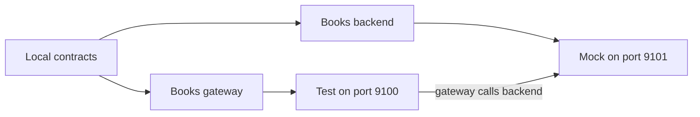

import CodeBlock from '@theme/CodeBlock';

# Start with local OpenAPI specs

These complete V3 configurations support OSS and Enterprise; the commands below run the `specmatic/enterprise` Docker image. Choose a mock, a test, or a test with a mocked dependency. You can use inline services first and move to reusable components when sharing definitions helps.

## Before you start

### Docker setup

Use Docker 23 or later with the `specmatic/enterprise` image and a valid [Enterprise license](/enterprise_onboarding/license_key) in `~/.specmatic`. Use Docker Engine on Linux, or enable [host networking in Docker Desktop](https://docs.docker.com/engine/network/drivers/host/#docker-desktop).

Run commands from the folder containing your `specmatic.yaml` and contract files. The commands mount that folder at the image's default working directory, `/usr/src/app`, and mount your license directory at `/root/.specmatic`. Host networking lets Specmatic reach local services and expose mock ports without port mappings.

The examples use ports **9100** and **9101**; both must be available. The optional demo application and combined scenario also require Node.js 20 or later and Bash. Specmatic itself runs inside Docker.

Each scenario below uses its own `specmatic.yaml`; save the configuration for the scenario you are running. Other recipes retain `CONFIG_FILE_PATH` when selecting a specifically named file is part of the example. Scenario-specific environment values are passed explicitly with `--env`.

## Mock an API

You need two files in the same folder: `books.yaml` (the API specification) and `specmatic.yaml` (the mock configuration). Follow the [Docker setup](#docker-setup) first.

**1. Save the API specification as `books.yaml`.** This sample defines `GET /books/{id}` and an example response for book `1`.

<CodeBlock language="yaml" title="books.yaml">{require('./includes/local-openapi/books.yaml?raw').trimEnd()}</CodeBlock>

**2. Save the mock configuration as `specmatic.yaml`.** The service belongs under `dependencies`; this scenario needs no system under test or components. The listener is set in `runOptions.openapi`.

<CodeBlock language="yaml" title="specmatic.yaml">{require('./includes/local-openapi/specmatic-mock.yaml?raw').trimEnd()}</CodeBlock>

**3. Run the mock from the folder containing both files:**

<CodeBlock language="shell">{require('./includes/local-openapi/mock.sh?raw').trimEnd()}</CodeBlock>

Expected output excerpts:

<CodeBlock language="terminaloutput">{require('./includes/local-openapi/mock.terminaloutput?raw').trimEnd()}</CodeBlock>

Open `http://127.0.0.1:9101/books/1`. The named example returns `{"id":1,"title":"Specmatic Handbook"}`. Stop the mock with Ctrl+C.

## Test an API

First save the sample [`books.yaml` specification](#mock-an-api) in your working folder and follow the [Docker setup](#docker-setup). Use your own API specification instead if you also update the config paths.

Save this file as **`specmatic.yaml`**. `systemUnderTest` selects the contract and `baseUrl` identifies your running application. Testing a service does not start it.

<CodeBlock language="yaml" title="specmatic.yaml">{require('./includes/local-openapi/specmatic-test.yaml?raw').trimEnd()}</CodeBlock>

Use your own service at `http://127.0.0.1:9100`, or save and start this tiny demo implementation in another terminal:

Demo implementation — save as demo-service.cjs

<CodeBlock language="javascript" title="demo-service.cjs">{require('./includes/local-openapi/demo-service.cjs?raw').trimEnd()}</CodeBlock>

<CodeBlock language="shell">{require('./includes/local-openapi/start-demo.sh?raw').trimEnd()}</CodeBlock>

When ready, the demo prints:

<CodeBlock language="terminaloutput">{require('./includes/local-openapi/start-demo.terminaloutput?raw').trimEnd()}</CodeBlock>

In your original terminal, run:

<CodeBlock language="shell">{require('./includes/local-openapi/test.sh?raw').trimEnd()}</CodeBlock>

Expected output excerpts:

<CodeBlock language="terminaloutput">{require('./includes/local-openapi/test.terminaloutput?raw').trimEnd()}</CodeBlock>

The named request is sent to the application and its response is checked against the contract. Stop the demo with Ctrl+C when finished.

## Test with a mocked dependency

First save the sample [`books.yaml` specification](#mock-an-api) in your working folder and follow the [Docker setup](#docker-setup). Both services below use this specification.

Save this file as **`specmatic.yaml`**. Two services share a local source: a gateway tested on port 9100 and a backend mocked on port 9101. Both use the Books contract. Their run options remain at the use sites, so the same source can support different runtime roles.

<CodeBlock language="yaml" title="specmatic.yaml">{require('./includes/local-openapi/specmatic-components.yaml?raw').trimEnd()}</CodeBlock>

The relationships are:

For a complete demo, save `demo-service.cjs` from the previous section and this response checker as **`verify-service.cjs`**:

Response checker — used to wait for the backend

<CodeBlock language="javascript" title="verify-service.cjs">{require('./includes/local-openapi/verify-service.cjs?raw').trimEnd()}</CodeBlock>

Stop any earlier demo/mock processes first. Run the following sequence with Bash. It starts the backend mock, starts the gateway with its dependency URL, runs the contract test, and stops both processes on exit:

<CodeBlock language="shell">{require('./includes/local-openapi/components-test.sh?raw').trimEnd()}</CodeBlock>

Expected output excerpts:

<CodeBlock language="terminaloutput">{require('./includes/local-openapi/components-test.terminaloutput?raw').trimEnd()}</CodeBlock>

A successful gateway response depends on the mocked backend returning the declared book. In your application, configure its real dependency client to call the mock URL; putting a dependency in `specmatic.yaml` does not change your application's client configuration.

## Validate the configuration file

Config validation checks structure and semantic rules. It is separate from validating examples or testing a running service. For Git/web sources it can fetch contracts and update local caches.

<CodeBlock language="shell">{require('./includes/local-openapi/validate.sh?raw').trimEnd()}</CodeBlock>

<CodeBlock language="terminaloutput">{require('./includes/local-openapi/validate.terminaloutput?raw').trimEnd()}</CodeBlock>

:::note Custom config paths in Enterprise 1.28.3
The released Enterprise mock orchestrator can retain its initially discovered path when `--config` is supplied. The starter examples use the default `specmatic.yaml`. Recipes that select a named file use `CONFIG_FILE_PATH` before command construction. The published commands now execute the Enterprise Docker image directly. Earlier OSS/Enterprise CLI results describe the configuration behavior at those recorded releases; they are not Docker execution evidence.
:::

## Adapt the examples

- Replace `books.yaml` with your specification path. Keep paths relative to the configured source and run from the documented folder.
- Set the test `baseUrl` to your application. Set a mock `host`/`port` to the listener you want. They serve different purposes.
- Add [external examples](/features/external_examples), [authentication](/features/authentication), [test options](/references/configuration/test-configuration) or [mock options](/references/configuration/mock-configuration) as needed.
- For private Git or downloaded contracts, start with [Contract Management](/references/configuration/contract-management).

If startup fails, check that the selected config and contract files exist and the ports are available. If the test fails, compare the reported request/response mismatch with your application. Use the [explorer](/references/configuration/explorer) to locate a setting before adding it.
